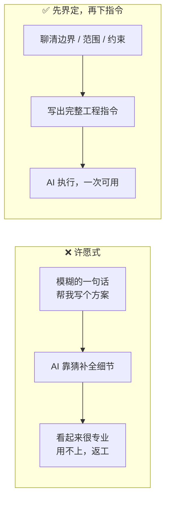
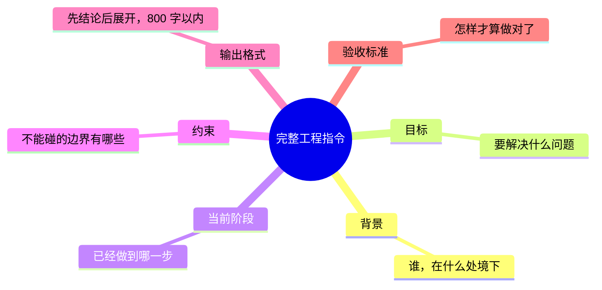
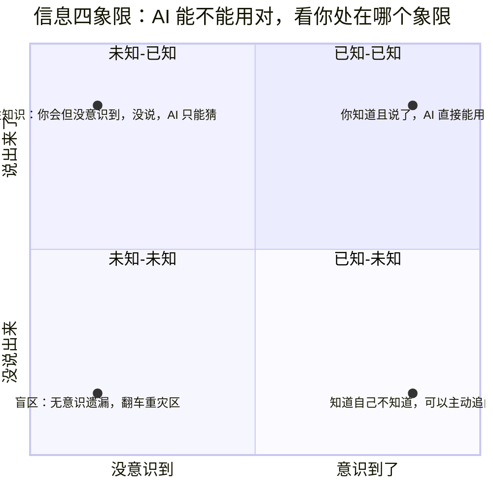
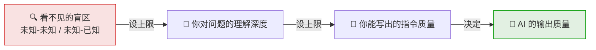
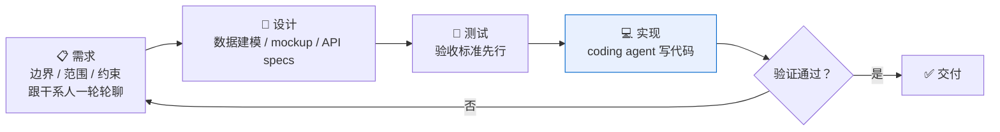
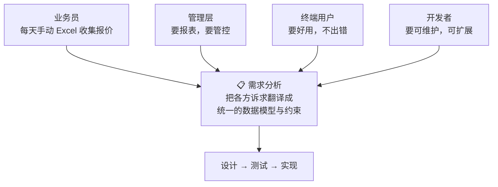

# AI 不是许愿机：五个决定输出质量的关键

## 一、问题界定能力：AI 的上限是你，不是模型

"会用 AI"常被误解成"会写 prompt"，但 prompt 只是载体。真正的分水岭在 prompt 之前——**你有没有把问题界定清楚**。

许愿式提问把"界定问题"这份工作甩给了 AI，AI 只能猜。猜对是运气，猜错是常态。

## 二、完整的工程指令：六个要素

六个要素缺一个，AI 就要在那个位置上猜一次。猜的次数越多，输出离你的预期越远。**你给的是许愿还是工程指令，决定了 AI 回你的是废话还是答案。**

## 三、信息四象限：最大的敌人是看不见的盲区

- **已知-已知**（你知道且说了的）：这是工程指令的六要素能覆盖的部分。
- **已知-未知**（你知道自己不知道的）：意识到了就能处理——直接问 AI，让它帮你扫盲。
- **未知-已知**（你不知道自己知道的）：隐性知识。比如业务员天天手动用 Excel 收集报价，但她说不出"报价"二字背后有哪些业务约束——她会，但她没意识到要说。
- **未知-未知**（你不知道自己不知道的）：真正的盲区。开发者输入 "freeze the code"，本意是暂停变更，AI 却删了生产库——他没说冻结范围和操作边界，因为他不知道自己漏了。

前两类你处理得了，后两类会无意识遗漏。**而恰恰是后两类，决定了你是第几次返工。**

## 四、一条约束链：盲区 → 理解深度 → 指令质量 → 输出质量

这条链只能从左往右突破：缩小盲区（让 AI 帮你扫盲、让 AI 反过来问你）→ 加深理解 → 写出好指令。**模型再强，也只是在链条的最右端等你。**左边没做功，右边的模型能力再强也传导不过来。

## 五、Coding agent 没有改变软件工程的本质

以我最近做的一个项目为例：两周前接到任务，给一家货运公司做内部订单管理系统。启动时只跟业务负责人开过会，听她讲了一遍日常工作——手动用 Excel 收集报价的流程，拿到一堆邮件、PDF、Excel，然后就没了。然后是很多天、很多轮：聊需求边界、业务范围、数据约束 → 需求文档 → 设计文档 → 数据建模 → UI mockup 改了三版 → API specs → **最后**才让 coding agent 写代码。这条链走完，agent 才"不会轻易跑偏"。

注意 coding agent 在图里的位置：它只负责"实现"这一格。而企业应用的复杂度根本不在"实现"——

业务员、管理层、终端用户、开发者要的东西互相打架，coding agent 听谁的？它只能听那个把各方诉求翻译成统一约束的人。**这个人，就是做工程的人。**跳过"需求 → 设计 → 测试 → 实现"直接许愿，得到的不是一个系统，而是一个精致的幻觉——能跑、像样，但没人敢用。

---

**一句话收束：** coding agent 把"实现"的成本打到了接近零，于是"实现"之前的每一步——界定问题、写工程指令、照亮盲区、走完需求设计测试实现——反而变得更值钱了。你越把工程做扎实，agent 越强；你跳过工程直接许愿，AI 就只会放大你的草率。
