# LobsterAI《中国办公 Agent 用户行为报告》2026 年 9 月版

> 数据来源：LobsterAI 真实用户行为数据——报告基于其自有产品的用户行为数据整理（非第三方全行业抽样）；报告未披露具体样本量，第三方报道称其 8 月用户数已突破 100 万。
>
> 原文出处：LobsterAI 官网博客《中国办公 Agent 用户行为报告（2026 年 9 月版）》，发布于 2026-10-19，
> https://lobsterai.youdao.com/blog/china-office-agent-user-behavior-report-2026-10
>
> 本文已逐项核对官网原长图（1080×12270 webp，单张完整长图），10 个章节无缺失、数字与原图一致。
> 图表数据按原图逐项还原，并用 Mermaid 重绘为可交互视图。报告声明：基于 LobsterAI 真实用户行为数据整理，仅供行业观察与参考，不构成任何投资或商业建议；统计口径可能随产品迭代调整，请以官方后续发布为准。

## 报告导语

第一期《中国办公 Agent 用户行为报告》发布后，引发了媒体和用户的关注与讨论。从本期起，按月发布报告，持续记录用户使用习惯的变化。本期聚焦 9 月的用户行为，并额外补充十一假期的使用变化。

9 月要点预告：用户单次任务规模继续增长；泛编程/IT 仍是办公 Agent 的主要用途，但设计与内容创作正在升温；缓存策略的差异为何能导致使用成本相差七倍多？哪些城市的用户深夜还在派活给 Agent？十一假期期间，使用高峰和任务需求又发生了什么变化？

---

## 01 办公 Agent 的第一大使用场景仍是泛编程；设计与内容创作正在升温

和 8 月相比，设计与内容创作的份额在上升，金融、教育、互联网产品运营在下降。

| 行业 | 任务份额 | 环比趋势 |
|---|---|---|
| 泛编程/IT | 40.1% | ↑ |
| 设计/影视/创作 | 17.2% | ↑ |
| 金融/财务 | 7.7% | ↓ |
| 工程/制造/建筑 | 7.0% | ↑ |
| 教育/教研 | 5.5% | ↓ |
| 销售/电商/客服 | 4.8% | ↑ |
| 学生/学业 | 3.6% | ↓ |
| 互联网产品运营 | 3.5% | ↓ |
| 市场营销/新媒体 | 3.1% | ↑ |
| 行政/人事 | 2.1% | ↓ |
| 医疗/健康 | 2.0% | ↑ |
| 政务 | 1.7% | ↑ |
| 法律/合规 | 1.5% | ↓ |

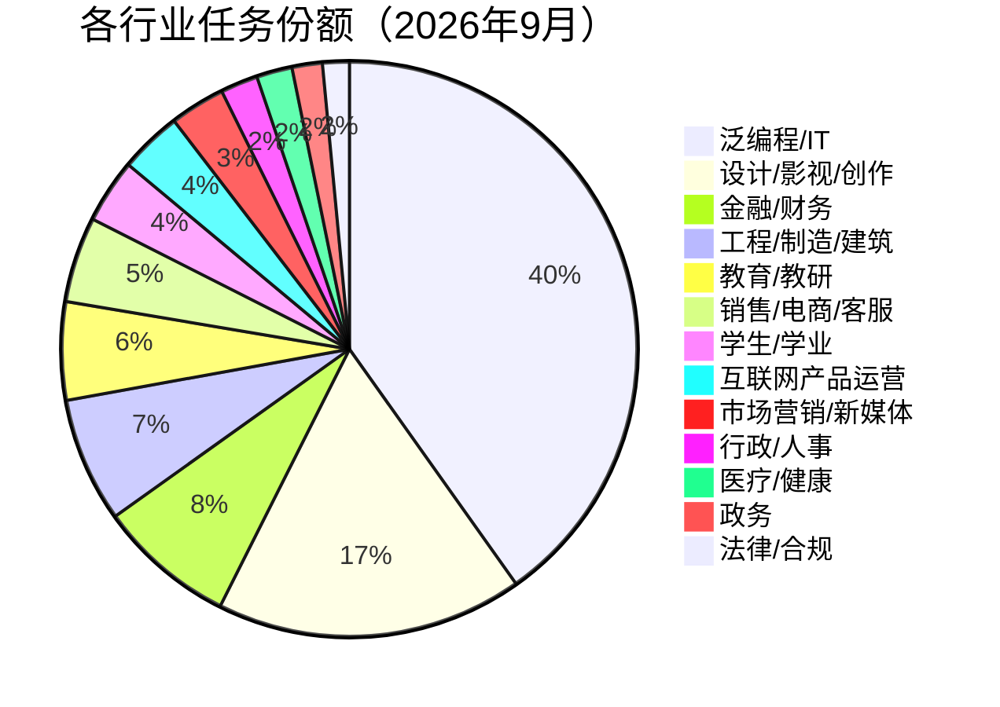

---

## 02 用户单次任务规模持续增长，越来越多的工作由 Agent 完成

用户单次任务规模达到历史峰值：从 3 月的 6.3 万增长至 9 月的 20.2 万，约为 3 月的 3.2 倍。

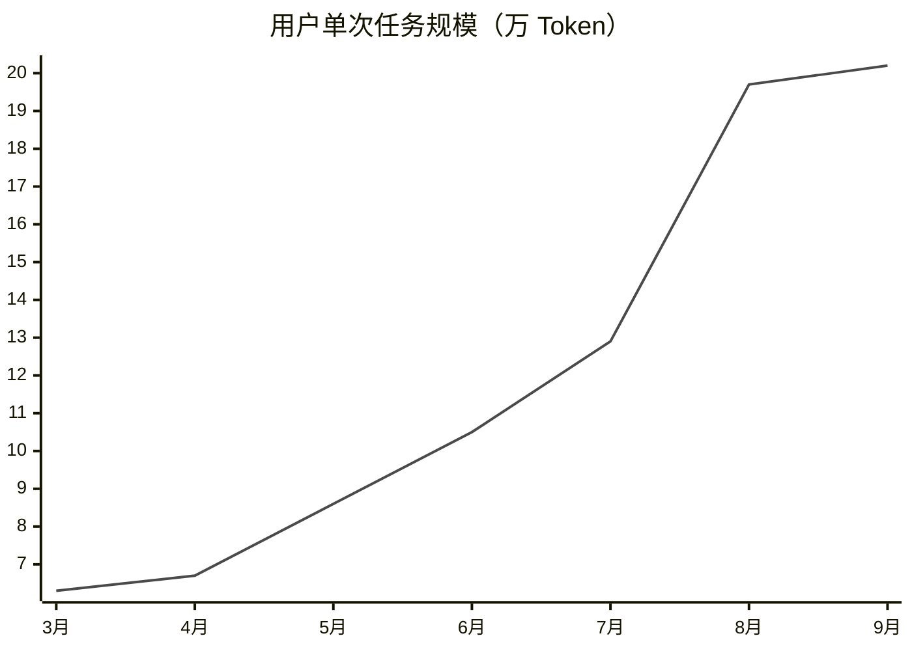

| 月份 | 3月 | 4月 | 5月 | 6月 | 7月 | 8月 | 9月 |
|---|---|---|---|---|---|---|---|
| 单次任务规模（万 Token） | 6.3 | 6.7 | 8.6 | 10.5 | 12.9 | 19.7 | 20.2 |

---

## 03 郑州跻身 Agent 活跃用户城市前 10；重庆的 Agent 深夜还在干活

### 活跃用户城市 Top10

| 排名 | 城市 | 占比 |
|---|---|---|
| 1 | 北京 | 5.7% |
| 2 | 上海 | 4.3% |
| 3 | 广州 | 4.2% |
| 4 | 深圳 | 3.4% |
| 5 | 杭州 | 3.2% |
| 6 | 成都 | 2.5% |
| 7 | 重庆 | 2.3% |
| 8 | 武汉 | 2.3% |
| 9 | 郑州 | 1.9% |
| 10 | 东莞 | 1.9% |

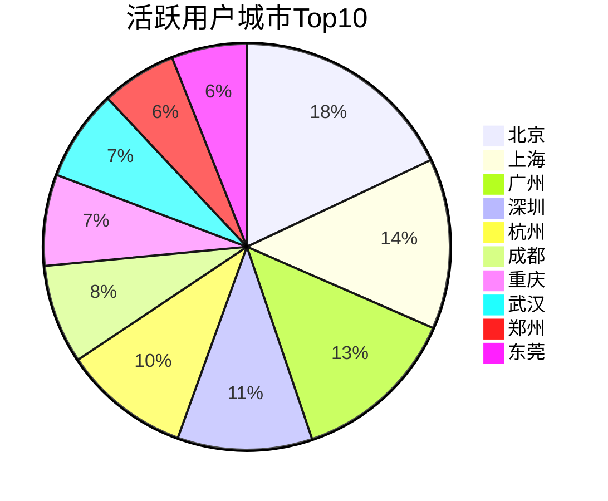

### 晚 10 点到凌晨 2 点占全天调用的比例（深夜干活榜）

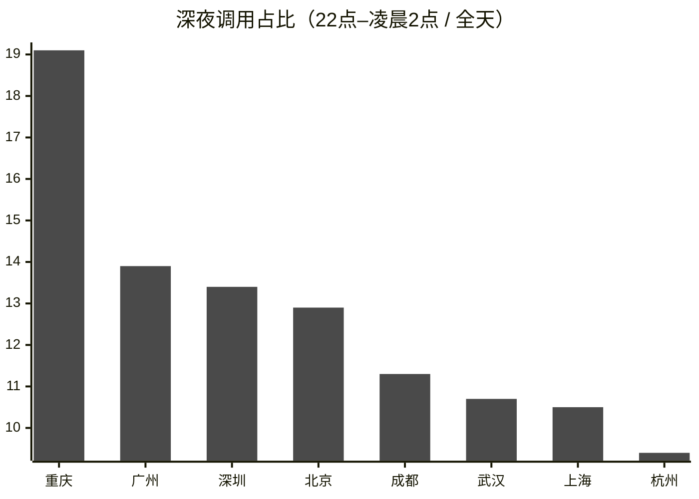

| 城市 | 深夜占比 |
|---|---|
| 重庆 | 19.1% |
| 广州 | 13.9% |
| 深圳 | 13.4% |
| 北京 | 12.9% |
| 成都 | 11.3% |
| 武汉 | 10.7% |
| 上海 | 10.5% |
| 杭州 | 9.4% |

---

## 04 微信是 IM 派活的第一入口；不少人早上通勤时已经开始安排工作

### 用户在哪些聊天软件里派活

注：同一个用户可使用多个 IM，比例合计可能超过 100%。

| IM | 占比 |
|---|---|
| 微信 | 77% |
| 飞书 | 14.3% |
| QQ | 6.5% |
| 企业微信 | 5% |
| 其他 | 5% |

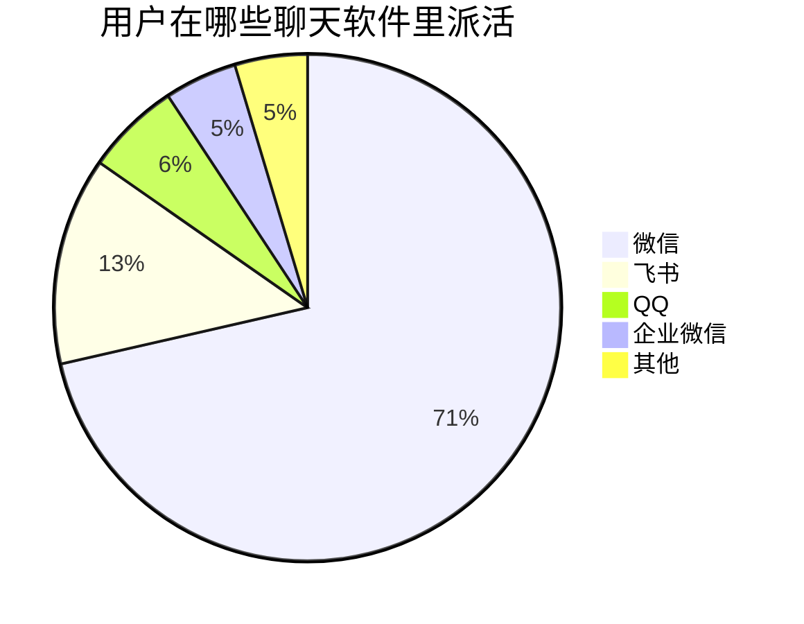

### 7 点到 11 点，用户更喜欢通过 IM 给 Agent 派活

24 小时曲线（桌面 vs IM）关键读数：

- 凌晨 0–6 点为全天低谷，桌面与 IM 均不足 1%。
- 早上 7 点后 IM 派活快速爬升，9–11 点超过桌面：9 点 IM 6.3% vs 桌面 4.8%；10 点 IM 7.1% vs 桌面 6.4%，为 IM 全天最高点。
- 下午 15–16 点为桌面小高峰（约 7%），IM 同步回落；18 点后两者趋同并缓慢下降。

结论：不少人早上通勤时已经在 IM 里给 Agent 安排工作。

---

## 05 国庆假期改变了 Agent 的工作节奏：使用高峰推迟，晚间使用占比上升

### 白天出门玩耍，晚上回家用 Agent 工作

十一假期里，凌晨 0 到 7 点的份额从 13% 升到 17%，高峰从下午 4 点推迟到晚上 10 点。

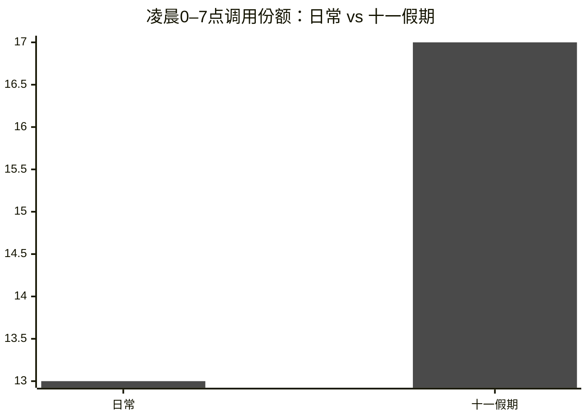

### 十一假期里，泛编程类工作占比升高

除泛编程任务外，学习、个人生活、文案相关的任务相比其他时间有增长（单位：份额百分点变化）。

| 任务类型 | 假期份额变化 |
|---|---|
| 泛编程/IT | +4.0 |
| 学习与教育 | +1.6 |
| 个人生活事务 | +1.6 |
| 营销文案 | +0.1 |
| 网页与工具制作 | -0.1 |
| 自动化配置 | -0.1 |
| 图像视频生成 | -0.2 |
| 信息检索与研究 | -0.3 |
| 法律财税 | -0.4 |
| 演示文稿 | -0.4 |
| 文档写作 | -0.5 |
| 金融与投资 | -0.7 |
| 翻译润色 | -1.6 |
| 数据与表格 | -2.9 |

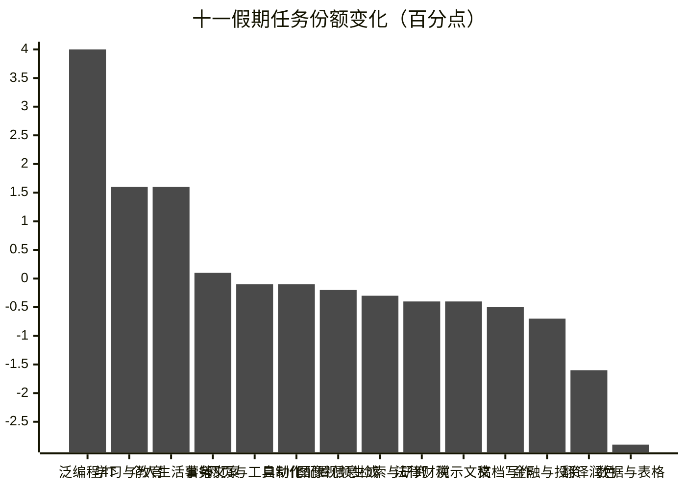

---

## 06 近七成用户只使用一个模型；重度用户更倾向于搭配更多模型使用

重度用户人均使用 2.4 个模型，普通用户人均使用 1.6 个。

| 使用模型数 | 重度用户 | 普通用户 |
|---|---|---|
| 1 个 | 44.7% | 73.6% |
| 2 个 | 24.7% | 14.7% |
| 3 个 | 13.1% | 5.1% |
| 4 个及以上 | 17.6% | 6.6% |

```mermaid
%%{init: {"themeVariables": {"xyChart": {"plotColorPalette": "#4a4a4a,#8c8c8c"}}}}%%
xychart-beta
    title "使用模型数量分布（%）"
    x-axis ["1个", "2个", "3个", "4个及以上"]
    bar [44.7, 24.7, 13.1, 17.6]
    bar [73.6, 14.7, 5.1, 6.6]
```

*注：橙色为重度用户，蓝色为普通用户。*

### 最常见的模型搭配

| 搭配 | 占比 |
|---|---|
| DeepSeek Flash 系列 + GLM 5.3 Flash | 14.0% |
| DeepSeek Flash 系列 + V4 Pro | 12.4% |
| DeepSeek Flash 系列 + GLM 5.3 FlashX | 2.2% |
| DeepSeek Flash 系列 + Qwen 3.8 Max | 2.1% |
| DeepSeek Flash 系列 + Qwen 3.8 Flash | 2.1% |
| DeepSeek Flash 系列 + GLM 5.3 | 1.8% |

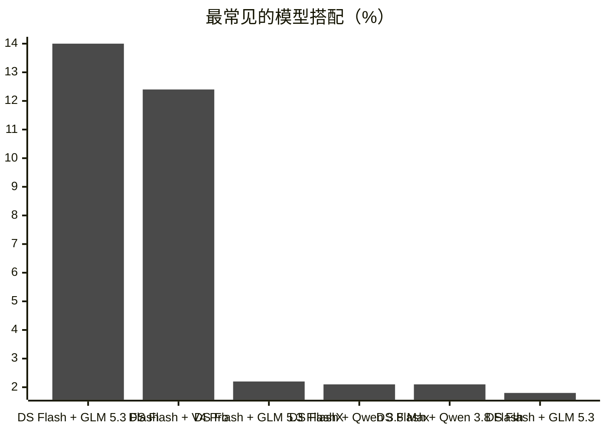

---

## 07 哪家模型厂商的缓存策略最好？最省钱？DeepSeek V4 系列模型一骑绝尘！

### 各模型 9 月的缓存命中率情况

| 模型 | 缓存命中率 |
|---|---|
| DeepSeek V4.1 Flash | 97.3% |
| DeepSeek V4 Flash | 95.7% |
| DeepSeek V4 Pro | 95.7% |
| DeepSeek V4 Flash Vision | 95.2% |
| GLM 5.3 | 93.9% |
| MiniMax M3 | 93.7% |
| Qwen 3.8 Max | 93.2% |
| Qwen 3.8 Flash | 92.8% |
| GLM 5.3 Flash | 91.1% |
| GLM 5.3 FlashX | 91.0% |
| Kimi K3 | 88.7% |
| Qwen 3.7 Plus | 76.7% |

### 算上缓存后，实际费用是原价的多少？

为什么命中率都在九成上下，花费却相差很多？关键在缓存折扣力度。

| 模型 | 实际费用 / 原价 | 缓存命中率 | 缓存价（折扣价 / 原价） |
|---|---|---|---|
| DeepSeek V4.1 Flash | 4.6% | 97% | 2% |
| DeepSeek V4 Flash | 6.2% | 96% | 2% |
| DeepSeek V4 Flash Vision | 6.7% | 95% | 2% |
| DeepSeek V4 Pro | 7.5% | 96% | 3.3% |
| Qwen 3.8 Max | 18.5% | 93% | 12.5% |
| Qwen 3.8 Flash | 18.8% | 93% | 12.5% |
| Kimi K3 | 20.2% | 89% | 10% |
| GLM 5.3 | 29.6% | 94% | 25% |
| GLM 5.3 Flash | 35.1% | 91% | 28.8% |

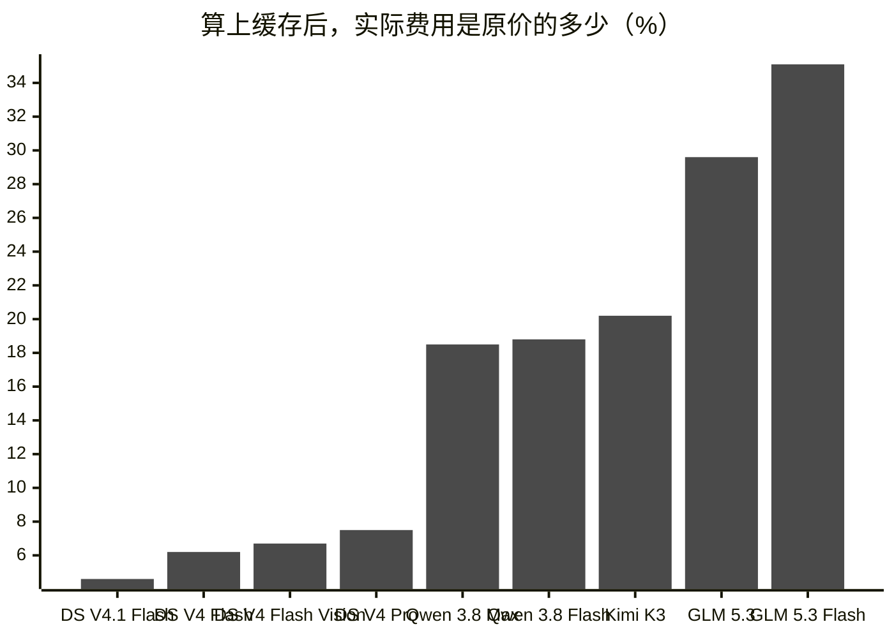

*解读：Agent 在执行任务时，往往需要反复读取任务要求和前期输入，不少费用就花在这些重复读取上。缓存会将读过的内容记住，再次读取并命中缓存时，用户即可享受折扣。各模型的折扣力度不同，最终省下的费用也不同——DeepSeek V4 系列缓存价仅为原价的 2%–3.3%，而 GLM 5.3 系列为 25%–28.8%，这就是"成本相差七倍多"的来源。*

---

## 08 头部模型厂商格局稳定；GLM 新模型带动智谱强势增长

### 国内模型厂商 Token 份额环比变化

| 厂商 | 环比变化 |
|---|---|
| 智谱 GLM | 约 +166.7% |
| DeepSeek | 约 -0.3% |
| 阿里 Qwen | 约 -18.2% |
| MiniMax | 约 -66.7% |
| 月之暗面 Kimi | 约 -78.6% |

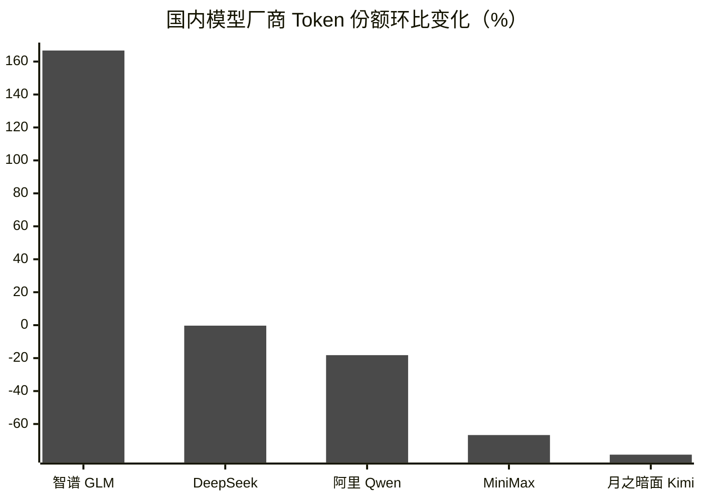

---

## 09 图像与视频生成任务中，Seed 系列模型的调用份额均超过一半

### 图像生成任务模型调用份额

| 模型 | 份额 |
|---|---|
| 豆包 Seedream | 57.2% |
| MiniMax Image | 36.0% |
| 阿里 通义万相 | 6.8% |

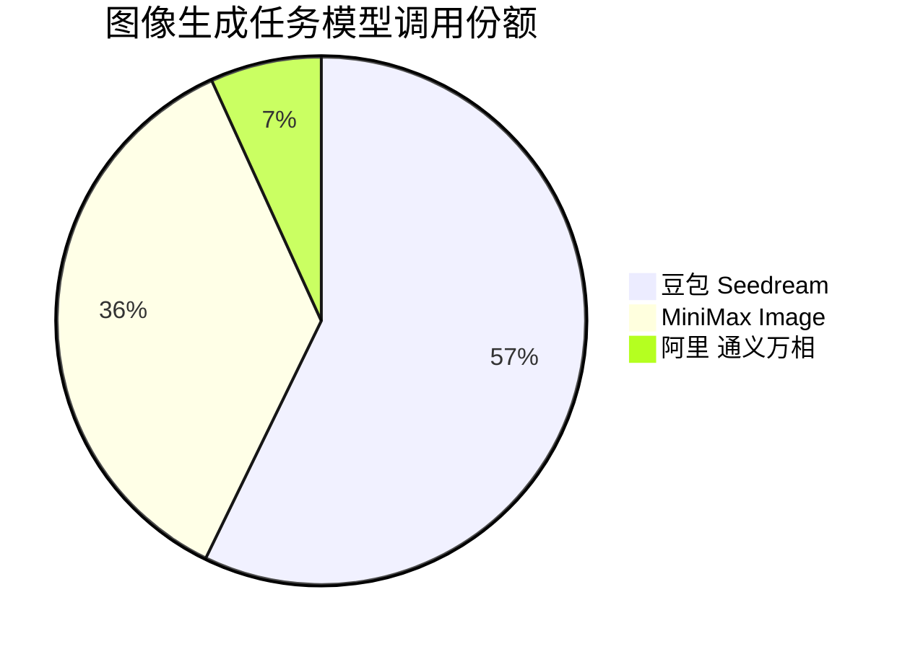

### 视频生成任务模型调用份额

| 模型 | 份额 |
|---|---|
| 豆包 Seedance | 54.4% |
| MiniMax 海螺 | 28.1% |
| 阿里 HappyHorse | 17.5% |

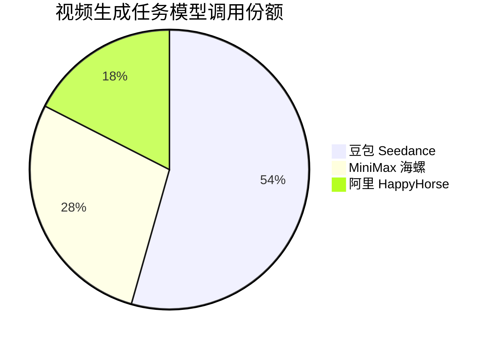

---

## 10 办公 Agent 用户规模加速扩大，正在融入更多人的工作日常

### 月度日均活跃用户变化趋势（环比增长率）

| 月份 | 5月 | 6月 | 7月 | 8月 | 9月 |
|---|---|---|---|---|---|
| 环比增长率 | — | +19.80% | +25.10% | +30.60% | +83.10% |

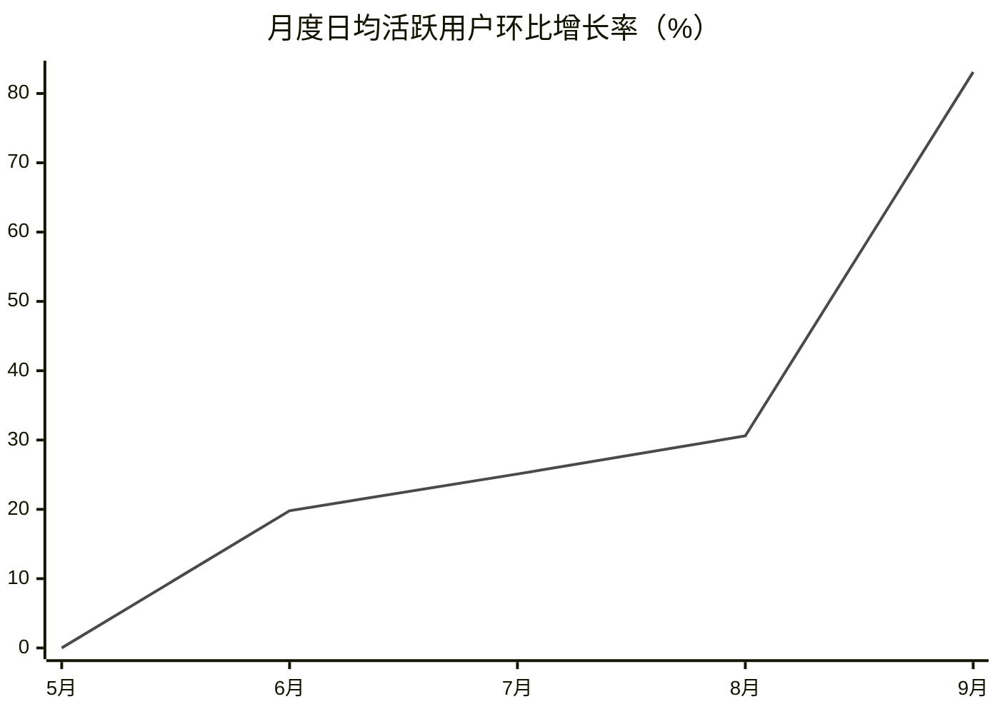

*注：原图纵轴为相对水平（未标注绝对值），9 月环比增速骤升至 +83.1%。*

---

*抽取说明：数据均为人工识读原长图逐项还原，已与官网原图全文核对，未改动原报告口径；第 04、05 节的 24 小时曲线只还原了原图标注的关键读数，未逐点估算。*
