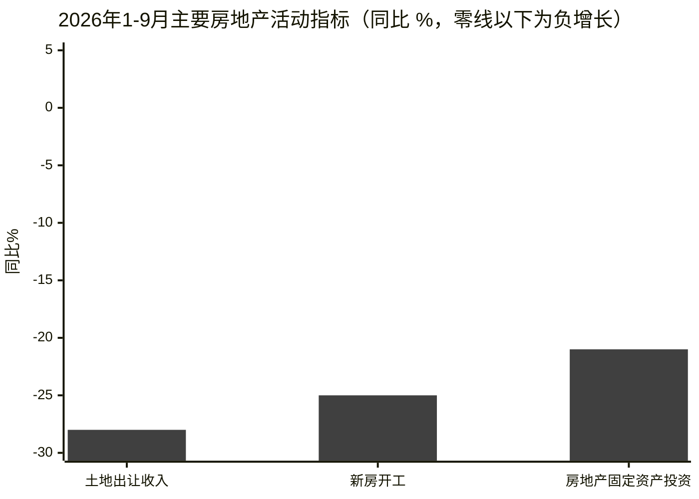
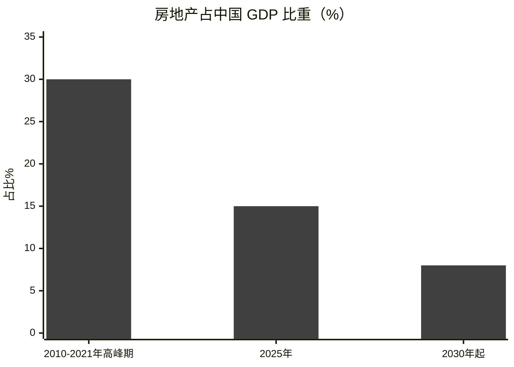
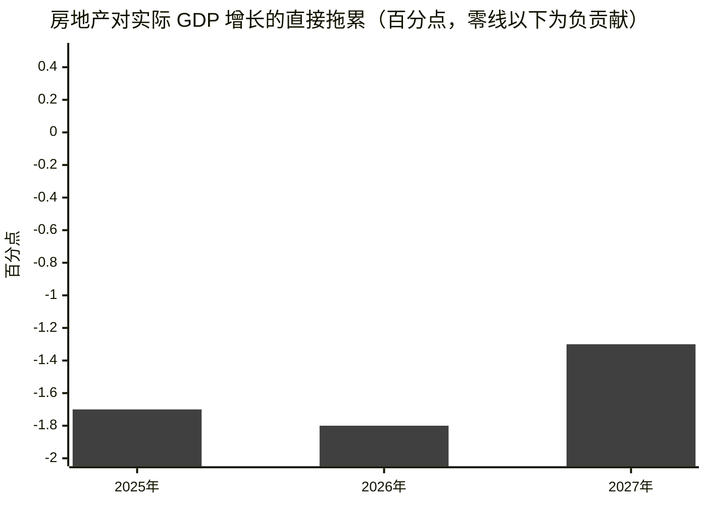
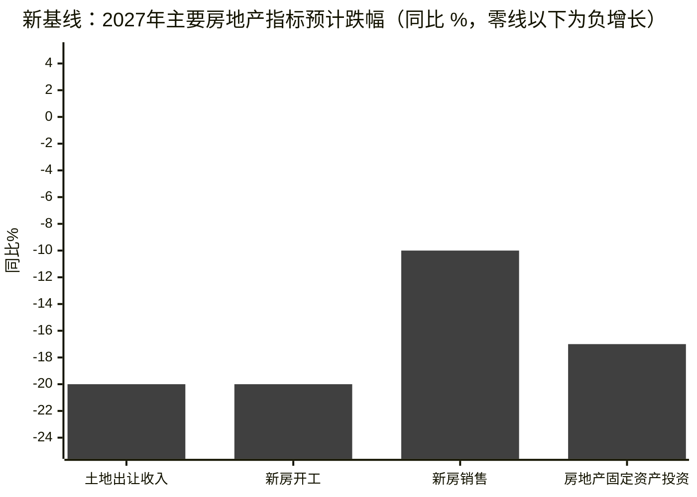
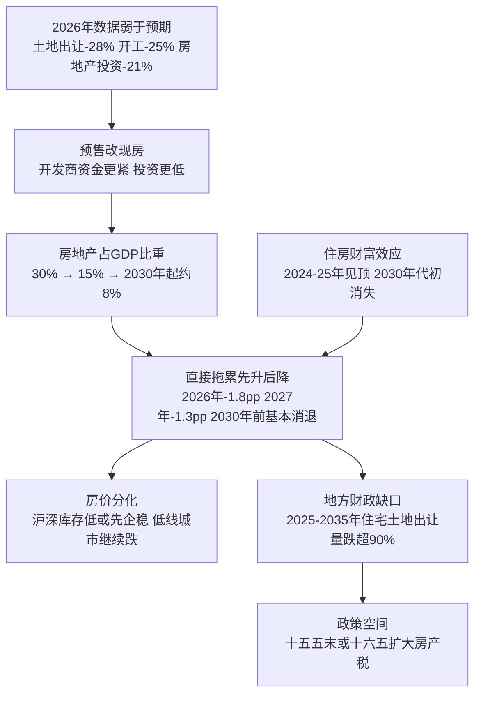

# 高盛《Asia in Focus：中国房地产下行更深，但拖累将逐步减轻》精读

> China: Property Downturn Deeper Than Previously Anticipated, But Its Growth Drag Should Still Ease Gradually in the Years Ahead

source: https://www.youtube.com/watch?v=xOF7Rm9oDko

> 原文：Goldman Sachs Global Investment Research, Economics Research, Asia in Focus 
> 作者：Yuting Yang、Lisheng Wang, Goldman Sachs (Asia) L.L.C.
> 日期：2026 年 10 月 25 日
> 说明：本文为对该研报的中文提炼与重述，非逐句翻译；图表根据报告披露的数据重绘，标注“示意”的为根据文字描述绘制的示意图。柱状图与趋势图颜色已统一指定为深灰色（#404040）。

报告的标题本身就是一对矛盾：下行“更深”，拖累却“逐步减轻”。全文的逻辑链其实不在楼市本身，而在分母——房地产在经济里的分量正在缩小，所以即使楼市继续跌，它一年一年拖累 GDP 的绝对值也会变小。**拖累减轻，不等于楼市好转；更多是算术上的收敛。**

---

## 一、今年的数据，比年初预期更差

中国房地产下行已进入第六年。高盛年初曾预计，今年房地产对 GDP 的拖累会比去年略有收窄，但 2026 年以来的多数指标都弱于预期。

2026 年 1～9 月：

- 政府土地出让收入同比 -28%
- 新房开工同比 -25%
- 房地产固定资产投资同比 -21%

到 2026 年 9 月，多数活动指标较 2020～2021 年高峰已下跌 60%～90%，包括新房开工、销售和房地产固定资产投资。也就是说，这轮调整的深度已经不是“回调”，而是量级上的收缩。

政策面又加了一层下行压力：近期宣布从预售制转向现房销售，并加强项目级资金监管。这意味着开发商资金更紧，未来几年的房地产投资更低。地产团队据此下调了 2027 年展望中的多数指标，其中 2025～2035 年的长期预测是：新房开工再跌 30%、竣工再跌 46%、房地产固定资产投资再跌 61%、新房销售再跌 70%。

需要注意一个口径差异：经济学团队的新基线输入与地产团队的预测不完全一致，因为两者要做定性调整，例如 300 城土地出让金额与地方政府土地出让收入的差异、商品房建筑与整体房地产建筑的差异。所以下面基线里的数字，和上面地产团队的长期预测不能直接混用。

---

## 二、模型怎么算：五条直接渠道，两处技术修正

这套住房模型是高盛 2018 年引入、此后不断更新的框架。它把房地产对实际 GDP 同比增长的贡献拆成五条直接渠道：

- 建筑施工
- 房地产服务
- 上游效应，主要是通过大宗商品需求
- 入住相关消费
- 土地出让相关的财政渠道

输入是一组房地产指标，包括新房开工、销售、在建面积、房地产固定资产投资和土地出让收入，以及它们与相关经济活动的历史关系。

这次更新做了两处技术修正，值得单独提，因为它们说明官方序列本身也在变化：

- **在建面积失真：** 近年资金严重短缺，大量开发商项目停工或终止，这些“卡住”的库存仍留在国家统计局的在建统计里，导致官方在建面积的跌幅看起来比新房开工暗示的要小。报告因此改用新房开工重估在建面积。历史上新房开工是在建面积较好的领先指标，但这一关系自 2023 年以来已明显弱化。
- **土地数据断档：** 国家统计局已停止发布开发商购地量序列，报告改用财政部的土地出让收入序列来替代开发商购地量和地价输入。

---

## 三、拖累的路径：2026 年最重，之后逐步收窄

先看分量。房地产在 GDP 中的占比，高峰期 2010～2021 年约为 30%，到 2025 年降至约 15%，新基线预计会继续下降，2030 年起稳定在约 8% 左右。

再看拖累。更新后的估计是：房地产 2026 年拖累实际 GDP 增长 1.8 个百分点，略高于 2025 年的 1.7 个百分点，也明显高于此前对 2026 年 1.5 个百分点的估计。预计 2027 年收窄约 0.5 个百分点至 1.3 个百分点，2030 年前基本消退。

新基线里，2026 年预计的跌幅是：土地出让收入 -30%、新房开工 -22%、新房销售 -8%、房地产固定资产投资 -20%；2027 年再跌：土地出让收入 -20%、新房开工 -20%、新房销售 -10%、房地产固定资产投资 -17%。

这里的关键不是 2027 年跌幅比 2026 年小，而是基数已经大幅缩水：同样的百分比，落在更小的盘子上，对 GDP 的百分点拖累自然收窄。

---

## 四、间接渠道：财富效应放大拖累，但不改变方向

上面的估计主要是直接影响，第二轮效应特别是住房财富效应也很重要。房产占中国家庭资产的一半以上，房价变动会实质影响信心和消费。

报告的测算方法是：用城镇房产价值乘以自建二手房价格序列的变动，得到家庭住房财富的年度变化；再用财富效应系数换算，即房产价值每变动 1 元，同向带动年消费变动 0.01 元。

按这一口径，负向住房财富效应在 2024～2025 年见顶。假设全国二手房价格如地产团队预期在 2030 年见底，负向财富效应会在未来几年逐步消退，2030 年代初完全消失。

算上间接财富效应，房地产对增长的影响会被放大，但报告的结论不变：**房地产对实际 GDP 增长的拖累，未来几年仍会逐步减轻。**

---

## 五、三个宏观含义

**第一，施工下行更深、更久。** 政府的目标是显著压减新房供给，所以施工 downturn 比此前预期更深、更持久。这意味着未来几年房地产对增长的拖累更大，只是会从今年的水平逐步缓和。

**第二，房价分化。** 上海、深圳等顶级城市库存已经较低，房价可能较快开始恢复。但其余地区，特别是有显著库存积压的低线城市，房价未来几年可能继续下跌。一线企稳不等于全国企稳。

**第三，地方财政压力持续。** 按开发商现金流测算，地产团队预计 2025～2035 年住宅土地出让量跌超 90%。这意味着地方政府融资压力会持续存在，尤其是在更依赖房地产相关收入的地区，需要另找收入来源或削减支出，才能保证财政可持续。

报告由此看到一个政策空间：在“十五五”（2026～2030 年）末期或“十六五”（2031～2035 年）期间扩大全国性房产税，拓宽地方税基，部分抵消土地出让收入的损失。但时机和范围，很可能取决于住房市场状况和国内市场信心。

---

## 全文逻辑一张图

## 一句话总结

这篇报告不是在说楼市要反转，而是在说楼市的“系统重要性”正在不可逆地缩小：拖累减轻，是因为房地产在经济里变小了，而不是因为它变好了；真正的悬念不在拖累的百分点，而在土地财政这个缺口由谁来补、以及补不补得上。

## 延伸讨论：拖累消退之后，什么还在

*以下为讨论观点，非报告原文。*

第一，“拖累基本消退”这个表述容易被误读。按报告的口径，2030 年房地产占比稳定在约 8%，拖累消失意味着它不再是 GDP 增长的减项，不意味着它重新成为增长引擎。一个 8% 的行业，和一个 30% 的行业，对政策、对银行资产负债表、对地方财政的意义完全不同。

第二，土地财政的替代方案，报告只点到房产税这一个方向，但没有展开政治难度：房产税扩围的税基、税率、豁免和征收能力，都是硬约束；如果房产税迟迟落不了地，缺口就只能由转移支付、发债或支出削减来填，每一种的分配含义都不一样。

第三，预售改现房是一次风险再分配：过去是购房者承担期房风险，现在风险更多压向开发商和为其融资的银行。这对购房者是保护，对供给是收缩，短期看是净负面，长期看能不能换来更稳的供给，取决于开发商还有没有能力在现房模式下算得过账。

第四，房价分化会放大区域分化。沪深先企稳、低线继续跌，意味着资产负债表修复的速度也不一样；全国性的平均数，未来会越来越掩盖区域之间的真实差异。

