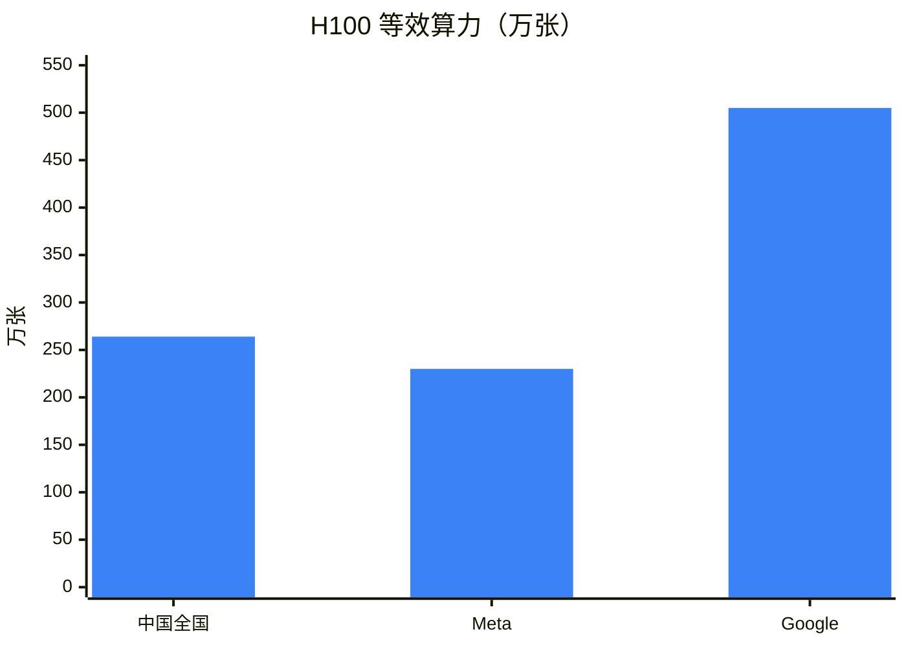
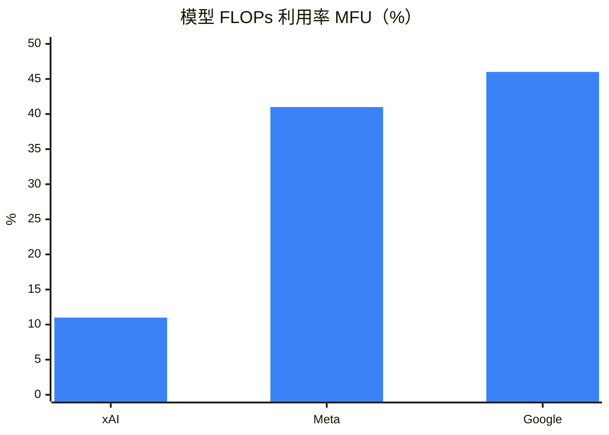
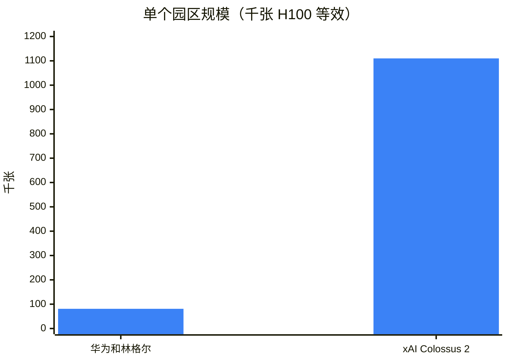
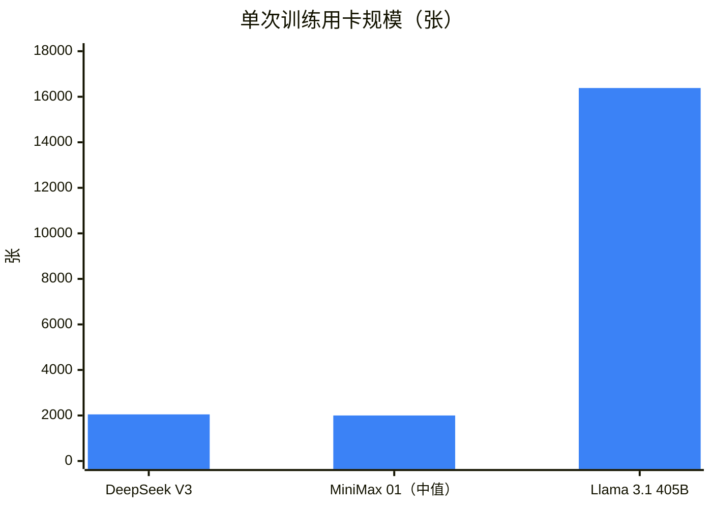
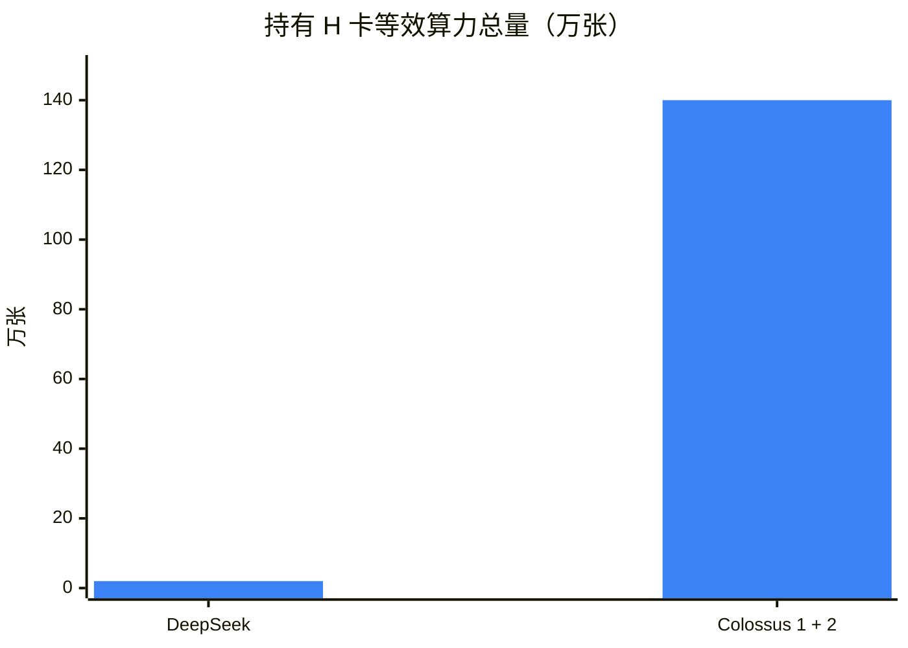
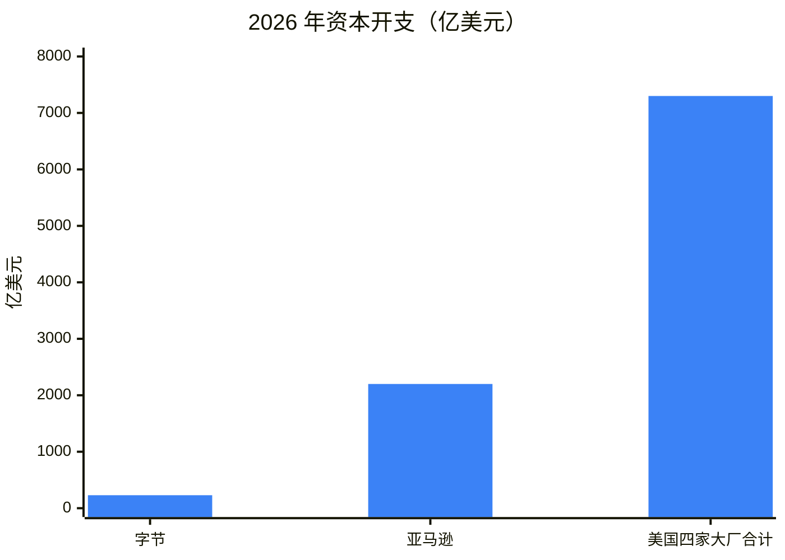
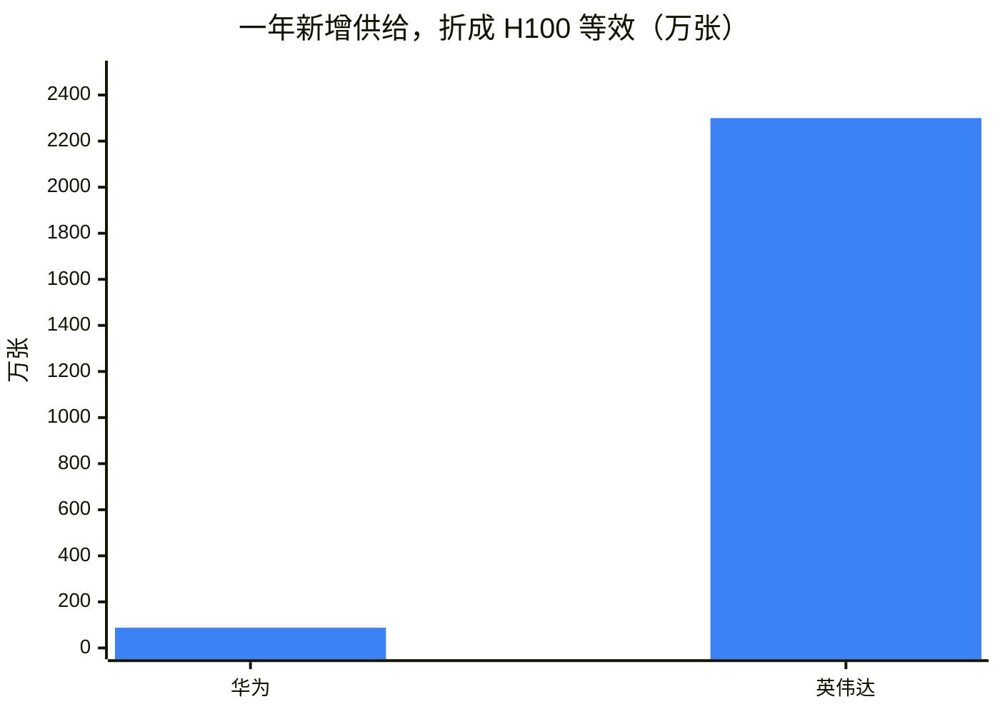
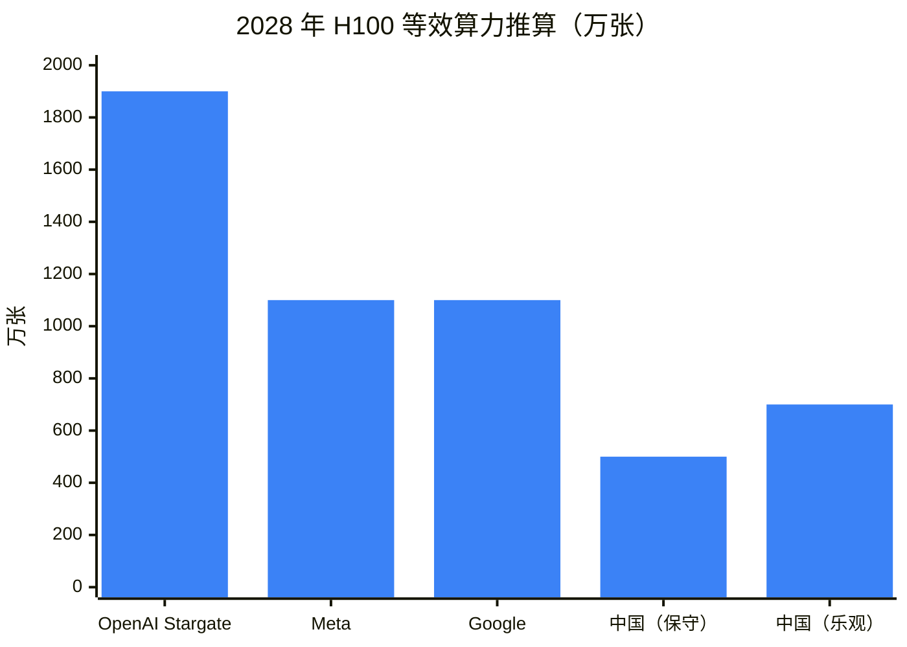
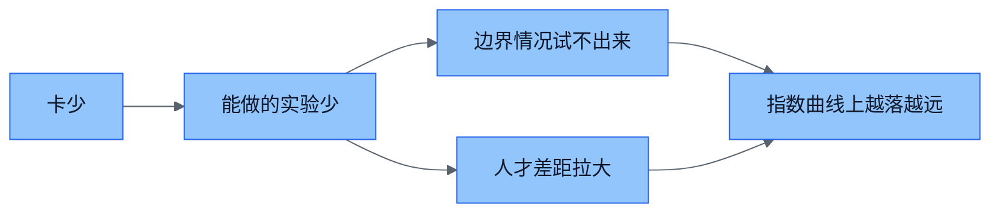

# 中国 AI 算力到底有多稀缺

- 来源：[BV1QDsc6WEJ8](https://www.bilibili.com/video/BV1QDsc6WEJ8)

## 全国总量：跟 Meta 一家差不多，但只有 Google 的一半

从 2022 年到今年，所有的 AI 芯片算力加起来，仅仅和 Meta 一家公司差不多。折算成英伟达的 H100：

- 中国全国大约 **264 万张**。这个数字有出处：Epoch AI 的 AI Chip Imports Explorer（2026 年 10 月 27 日）估算，2022 年至 2026 年 6 月累计运抵中国的算力为 260 万张 H100 等效（区间 190 万至 420 万，含国产芯片），264 万是同一份数据的精确值。
- 视频给出的 Meta **259 万张**、Google **355 万张**，交叉验证未找到出处。Epoch 的公司级数据（2025 年底）给出的是 Google 约 **505 万张**、Meta 约 **230 万张**。也就是说，按能找到的公开数据，中国全国跟 Meta 一家差不多，但只有 Google 的一半左右。

这里有一个口径问题：中国的 264 万是国家层面的海关进口累计，Meta、Google 的数字是公司持有量，两份数据来自 Epoch 的不同数据集，不能直接当成同一口径的对比。视频的“打平”结论，只在 Meta 这一家上成立。

H100 是英伟达 2022 至 2024 年最主流的 AI 训练卡（2022 年 3 月发布，80GB HBM3），至今仍是行业通用的折算单位“H100 等效”。到 2025 至 2026 年，前沿已转向 Blackwell（B200/B300，单张约 2.5 张 H100 等效）和 Rubin，H100 不再是最新旗舰。

注：本图已按交叉验证更正。Meta、Google 取 Epoch 2025 年底公司级数据（230 万、505 万），中国取 Epoch 2022 至 2026 年 6 月累计进口数据（264 万）。两者口径不同，见正文。

## 纸面算力不等于真实算力

### H20：一张只顶 0.15 张 H100

国内数量最多的卡，是英伟达专门给中国市场降了规格的 H20。CMBI 2025 年 7 月 16 日的报告预估，2025 年中国对 H20 的总需求会达到 150 万至 160 万张——视频说的约 149 万张就是这个预估数，不是已交付、已装机的确认数。H20 在 2025 年 4 月被许可限制，之后北京又不鼓励使用，英伟达也通知供应商停产，所以 149 万只能当作分析师的需求预估。

折算比本身是对的：H20 的 FP16/BF16 张量算力约 148 TFLOPS（稠密），H100 SXM 约 989 TFLOPS，148 / 989 ≈ 0.15。149 万张折完约 22 万张 H100 等效，这笔算术没错。

值得注意的是，这上面的数据都是纸面的峰值。真跑起来到底能把一张卡发挥出多少，就要看每一家公司 Infra 的能力了。

### 利用率：11% 对 40% 以上

2026 年 4 月，有报道说马斯克的 xAI 模型算力利用率只有 **11%**。这不是 xAI 的公开披露，而是 The Information 首报、Business Insider 在 4 月 16 至 17 日的报道中确认的：xAI 总裁 Michael Nicolls 在内部备忘录里说，模型 FLOPs 利用率（MFU）“低得难堪”，约 11%，目标是几个月内提到 50%，行业区间是 35% 至 45%。视频说的“今年 5 月”错了一个月——5 月是 Anthropic 租下 Colossus 1 的时间。

MFU 是训练效率（有用 FLOPs 除以峰值 FLOPs），不是机房“闲置还是忙碌”的意思。55 万张卡按 11% 算只当约 6 万张在用，这笔算是视频作者自己的算术，不是公开数字。

Meta 和 Google 的情况：Meta 的 Llama 3 论文报告 MFU 为 **38% 至 43%**（16,384 张卡、8k 上下文时为 41%），也就是说“四成以上”只在部分配置上成立，不是全线都超过 40%。Google 的 PaLM（2022 年）报告为 **46%**。

注：Meta 一栏画的是 41%（Llama 3 论文在 16,384 张卡时的取值），实际区间为 38% 至 43%。

### DeepInfer，不是 DeepEP

另一边，DeepSeek 的生产推理框架 **DeepInfer**，让同一张卡的吞吐量比之前快了很多，一个集群一天就能处理 **155 万亿个 token**。这个数字本身有出处——DeepInfer 随 DeepSeek-V4.1-Flash 部署问答发布于 2026 年 10 月 20 日，原文是“单个集群目前每天服务 155 万亿 token，谷电价下每 GPU 小时收入 38 美元”——但视频把名字说错了：**DeepEP 不是框架，只是 DeepInfer 里面的一个组件核函数库**（专家并行通信），与 FlashMLA、DeepGEMM 并列。

### 而且 264 万已经是往多了算的

它是 2022 年以来所有运到中国的卡：老卡没扣，报废的没扣，政府、科研、云服务、各行各业的全算在里面，不光是大模型公司的。

美国那边反过来只算了美国本土被统计到的机房，海外的、没统计到的都不在里面。这样算下来才勉强打平，真实的差距比这还大。

## 散在各处，拼不成一台机器

这 200 多万张卡还不在一个地方训一个大模型。要把成千上万张卡连在一起，同时干一件事。卡散在各家公司、各个机房，总数再大，也拼不成一台机器。

那就看单个园区。国内已知最大、能估出规模的是华为在内蒙古和林格尔的园区，大约 **8.1 万张** H100 等效。马斯克 xAI 的 Colossus 2，一个园区就是 **111 万张**。

这两个数字都来自 Epoch AI 2026 年 11 月 6 日的报告《What Huawei's Horinger data center reveals about China's compute gap》，是 Epoch 根据卫星影像、散热模型和芯片销售分配做的估算，不是华为或 SpaceX 的官方披露。和林格尔的 90% 置信区间是 3.6 万至 14.1 万张（点估计 8.1 万张，约 10.5 万颗 Ascend 910C 加 8,000 颗 910B，286 MW IT 功率）。Colossus 2 约 111.2 万张。

咱们最大的一个，是人家的 1/14。人家这一个园区就顶咱们全国的四成多（111 / 264 ≈ 42%）。

## 一次训练的规模差：集群是 1/63，单模型是约 1/8

再看训练。DeepSeek V3 已经是前年发布的模型，过时很久了，在技术报告里写的是用了 **2,048 张 H800** 进行训练，**278.8 万个 H800 GPU 小时**，只算最后正式训的那一遍（预训练 266.4 万、上下文扩展 11.9 万、后训练 0.5 万 GPU 小时，按每 GPU 小时 2 美元计约 557.6 万美元）。报告出自 DeepSeek-V3 技术报告（arXiv:2412.19437，2024 年 12 月）。H800 是 H100 给中国的版本，NVLink 带宽从 900 GB/s 砍到 400 GB/s，算力本身基本没动。MiniMax 的 01 模型用的也是 **1,500 到 2,500 张** H800（MiniMax-01 技术报告，2025 年 1 月，第 14 页）。

Meta 那边，视频把两个数字混在了一起，需要拆开：

- **12.9 万张 H100 是 Meta 的集群规模，不是某个模型的训练用量。**Meta 在 2025 年 9 月介绍过，把五座数据中心腾出来，建成一个横跨五座生产数据中心的 12.9 万张 H100 集群。
- **单模型训练方面，最有据可查的是 Llama 3.1 405B：最多用了 16,384 张 H100**，在 15.6T token 上预训练，共 3,084 万 H100 GPU 小时，MFU 38% 至 43%（Llama 3 论文，2024 年 7 月）。视频字幕里含糊的“163”，最可能就是 16,384 的误听。
- Llama 4 是在超 10 万张 H100 的集群上训练的（扎克伯格在 Meta 2024 年第三季度财报电话会上说的），但模型卡上只报告了 Scout 加 Maverick 合计 738 万 H100 GPU 小时，没有任何一个单模型用 12.9 万张卡训练的数字。

所以“一次训练是人家的 1/63”这个说法要改：按集群规模算，2,048 张对 12.9 万张，约是 1/63；按单模型训练用卡算，2,048 张对 16,384 张，约是 1/8。两者不是一回事。

注：MiniMax 一栏取 1,500–2,500 张的中值 2,000 张画图，原文是区间不是单值。Meta 一栏已按交叉验证更正为 Llama 3.1 405B 的 16,384 张，12.9 万张是集群规模，见正文。

到今年，DeepSeek 手上一共也就 **2 万张**左右 H 卡等效的算力。这是梁文峰自己的话，出自 2026 年 5 月 20 日约 4 小时的投资人交流会（流出纪要，2026 年 7 月见诸二次转录，无官方发布）：“我们现在大概是两万张 H 等效算力，其中大部分是最近一两个月刚到。”

xAI（SpaceX）在美国的园区合计约 **140 万张**。这个总数对得上 Epoch 的算法：Colossus 1 约 27.6 万张加 Colossus 2 约 111.2 万张，合计约 138.8 万张。但要注意，这是**两个**园区（Colossus 1 加 Colossus 2），不是视频说的三个园区。

## 谁更舍得花钱：资本开支

国内最舍得花钱的是字节。据英国《金融时报》2025 年 12 月 22 日报道，字节 2026 年初步计划的资本开支是 **230 亿美元**，差不多 1,600 亿人民币（2025 年约 1,500 亿人民币，其中约 850 亿人民币用于 AI 处理器）。亚马逊一家今年是 **2,200 亿美元**，是字节的约 1/10，这个数字来自亚马逊 2026 年第三季度财报（2026 年 10 月 29 日）。美国四家大厂——亚马逊、Google、微软、Meta——加起来大约 **7,300 亿美元**，是字节的 30 多倍；按 2026 年 10 月的指引加总，区间是 7,200 亿至 7,400 亿美元，中点约 7,300 亿（亚马逊约 2,200 亿、Alphabet 1,950 亿至 2,050 亿、微软约 1,700 亿、Meta 1,350 亿至 1,450 亿）。

这些钱两边都是集团口径，盖楼、普通云业务都算在里面，不全是买卡。各家的统计口径也不完全一致（亚马逊是现金资本开支，微软、Meta 含融资租赁，微软按财年算），所以 7,300 亿只能当作量级上的加总，不是干净的总数。

补充一点：字节的 230 亿美元只是初步计划。2026 年 5 月《南华早报》报道，字节已把 2026 年资本开支上调至少 25%，至约 2,000 亿人民币（约 280 亿美元）。

## 造卡的速度也差得远

按机构预测，华为今年一年出货大约 **150 万颗**，英伟达卖给全世界的大约 **590 万颗**，颗数差四倍。可一折成算力，华为 **88 万张** H100 等效，英伟达 **2,300 万张**，是 1/26。

这里的年份是 **2026 年**，数字是 Epoch AI 2026 年 9 月报告《Will Huawei catch up to Nvidia by 2030?》的中位预估（生产量，不是已审计出货量）：“2026 年，华为预计生产 150 万颗，英伟达 590 万颗；华为的 150 万颗折合 88 万张 H100 等效，英伟达的 590 万颗折合 2,300 万张。”23 / 0.88 = 26.1，所以“1/26”比报告原文说的“约 25 倍”更精确。作为对照，华为 2025 年约 80 万颗，英伟达约 450 万颗。

国产卡单张弱、数量又少，两个一乘，就差了 26 倍。

## 2028 年：差距还在拉大——但这组数字是推算，不是已建成的产能

美国这几年在建的大机房，到 2028 年底会陆续建成。按各家公开的建设进度推算，到时候 OpenAI 星际之门（Stargate）的几个园区加起来 **1,900 多万张** H100 等效，Meta **1,100 多万张**，Google 也是 **1,100 多万张**。

这组 2028 年的数字要分开看，不能都当成事实：

- **Stargate 的 1,900 多万张，与 Epoch 的推算基本对得上。**Epoch 2026 年 4 月 23 日的文章《OpenAI Stargate: where the US sites stand》说，七个美国站点、9 GW 以上规划容量，“足以支撑相当于 2,000 万张英伟达 H100 的算力”。分站点推算：Abilene 100 万、Shackelford 420 万、New Mexico 460 万、Milam 250 万、Wisconsin 260 万、Michigan 290 万，六个站点合计 1,780 万，加上第七个站点俄亥俄，约 2,000 万。但这只是**规划产能的推算，不是已建成的产能**，而且总数会随 Epoch 每次修订而变。
- **Meta、Google 的 1,100 多万张，未找到匹配的公开来源。**另一份基于 Epoch 的情景模型（Memorandum，2026 年 9 月 18 日）推算 2028 年底是 Meta 1,600 万张、Google 3,500 万张，比视频的数字高得多。视频的 1,100 万可能是只加总了已追踪的大站点，是作者自己的算法，不是公开数字。
- **中国保守 500 多万张、乐观 700 多万张，同样未找到匹配的公开预测，是作者自己的情景推算。**最接近的公开预测指向相反方向：Institute for Progress（2026 年 10 月 19 日）估算，中国可获得的算力在 2026 年底为 460 万张 H100 等效，到 2027 年底升至 880 万张——已经超过视频对 2028 年的乐观估计。差别可能在于口径：IFP 的口径含海外云租赁、走私和进口，视频的口径 presumably 只算自有或国产，但视频没有说明口径。
- **香港那 60 万颗，型号说错了。**路透社 2026 年 11 月 5 日报道，约 60 万颗英伟达先进 AI 芯片存放在香港，等待运往中国内地——型号是 **H200，不是 H20**，北京尚未批准大规模进口。
- **乐观情形假设的“华为产能翻倍”，只是华为路线图的说法。**华为在 2025 年 Connect 大会上的路线图承诺每个版本算力翻倍，Ascend 950 到 970 到 2028 年单卡算力提升 7 倍。但 Epoch 的评估是，华为到 2030 年仍落后英伟达约 4 年，仅靠国产 HBM，到 2028 年年产量约 150 万张 H100 等效（约英伟达的 1.5%）。“翻倍”是路线图目标，不是已验证的产能结果。

今天咱们全国还能跟人家一家打个平手，到 2028 年只剩人家一家的一半到 1/4——这是视频作者按上面这组推算得出的结论，不是已核实的事实。

单个园区也一样。和林格尔到 2028 年预计 **14 万张**，Meta 的 Hyperion 第一期就是 **414 万张**，从 1/14 变成 1/29。这两个数字有出处，都是 Epoch 的推算：和林格尔南区新楼预计 2028 年 2 月投用，届时约 14.1 万张（90% 置信区间 6.5 万至 22.7 万张）；Hyperion 在 2028 年第一季度预计为 414.3 万张 H100 等效（1,632 MW IT 功率，资本开支 618 亿美元），第一期 2028 年 1 月 1 日投用，目前仍是 0、在建。

注：本图是视频作者的 2028 年推算，不是已建成产能。Stargate 与 Epoch 2026 年 4 月的推算（约 2,000 万张）基本一致；Meta、Google、中国三组数字未找到匹配的公开来源，见正文。

## 卡少真正的代价：没有试错的空间

这不是说国内的技术差。国内最好的团队，大概是在用美国 1/20 的算力追着人家跑。可卡少就没有试错的空间。

做模型不是一次就训成的。DeepSeek V3 报告里那 2,048 张卡、278.8 万个 GPU 小时，只是最后正式训的那一遍，报告里明确写了不含此前的研究和消融实验。在这之前换架构、换算法、换数据，做了多少实验都不在这个数里。

梁文峰在一次投资人交流会上说过——这是流出来的纪要——因为算力少，我们能做的实验机会比较少，所以我们的人才整体上比美国有差距。人才的差距本质上也是因为算力的差距。

这段话有出处，但不是官方发布。原话出自梁文峰 2026 年 5 月 20 日约 4 小时的投资人交流会，2026 年 7 月见诸二次转录，至今没有 DeepSeek 官方发布的录音或纪要，真实性建立在多份内容一致的二次转录上。原话是：“人才不是瓶颈，资源是最大的瓶颈。资源首先影响到人才培养，因为算力少，我们能做的实验机会比较少，所以我们的人才整体上比美国有差距。人才的差距，本质上也是因为算力的差距。”

我们之前讲模型的 test 时说过，一个模型好不好用，很多时候差在边界情况上，这些都得一遍一遍试出来。人家能同时开好多条路去试，咱们一条路试错了都心疼。

AI 这几年是沿着一条指数曲线往上走的，每一代模型都站在上一代的实验结果上。在指数曲线上，幂次上只差一点头，一两年看不太出来，再过几年就是好几倍。

## 结论

全国加起来跟 Meta 一家差不多（264 万对 230 万），但只有 Google 的一半左右（505 万）；最大的园区是人家的 1/14；单模型一次训练用卡约是人家的 1/8，集群规模约是 1/63；一年的投入是亚马逊的 1/10、美国四家大厂合计的约 1/32；而且这个差距还在拉大。

说国内的大模型公司是一群无卡野人，一点都不夸张。希望后面咱们的产能能进一步扩大，等计算资源慢慢丰富起来，每家公司都能走出有自己特色的路，不用在算力上受制于人。

---

## 附录：交叉验证——数据源引用与标注列表

交叉验证做于 2026 年 11 月 17 日，针对公开网络来源。总体结论：**视频的大部分数字能追溯到 Epoch AI**——AI Chip Imports Explorer（2026 年 10 月 27 日）、AI Data Centers 目录、AI Chip Owners 数据，以及华为报告（和林格尔，2026 年 11 月 6 日；华为路线图，2026 年 9 月）。引用 Epoch 的地方通常准确；混合数据集、改换产品名、或推到 2028 年的地方，就会出错或变成作者自己的算术。Bilibili 视频本身没有为这次验证重看，字幕层面的细节（如“163”）无法独立确认。

### A. 数据源引用

- Epoch AI, “Where are the world's AI chips?”（AI Chip Imports Explorer），2026 年 10 月 27 日 — https://epoch.ai/latest/introducing-the-ai-chip-imports-explorer
- Epoch AI, “What Huawei's Horinger data center reveals about China's compute gap”，2026 年 11 月 6 日 — https://epoch.ai/publications/huawei-horinger-china-compute-gap
- Epoch AI, “Will Huawei catch up to Nvidia by 2030?”，2026 年 9 月 — https://epoch.ai/publications/huaweis-roadmap-to-2031
- Epoch AI, Meta Hyperion 目录 — https://epoch.ai/data/ai-data-centers/directory/meta-hyperion
- Epoch AI, “OpenAI Stargate: where the US sites stand”，更新于 2026 年 4 月 23 日 — https://epochai.substack.com/p/openai-stargate-where-the-us-sites
- Epoch AI, AI Chip Users 方法说明，2026 年 9 月 — https://epoch.ai/data/ai-chip-users-documentation/methodology
- Epoch AI 公司级芯片持有数据，2025 年底（二次汇总）— https://intelligenceprogress.com/infrastructure ；https://abxk.ai/en/physical-ai/ai-data-centers/
- DeepSeek-AI, DeepSeek-V3 技术报告，arXiv:2412.19437，2024 年 12 月 — https://arxiv.org/abs/2412.19437
- MiniMax-01 技术报告，2025 年 1 月（GPU 区间见第 14 页 §3）— https://archdb.vladsavinov.com/models/minimax-m1/
- DeepSeek DeepInfer（GitHub，2026 年 10 月 20 日发布；部署问答引述）— https://cellcog.ai/blog/deepseek-deepinfer-open-source/ ；https://www.aighten.com/en/blog/deepseek-deepinfer-open-source-inference-engine
- CMB International, H20 行业报告，2025 年 7 月 16 日 — https://hk-official.cmbi.info/upload/1635e86c-3999-4df7-9b3b-f6ef05cfb24c.pdf
- Nvidia H20 规格 — https://www.aquanode.io/blog/nvidia-h20-guide ；H800 对比 H100 — https://aixx.ai/wiki/card/nvidia-h800.html
- Meta 12.9 万张 H100 集群 — https://www.datacenterdynamics.com/en/news/meta-emptied-five-live-data-centers-to-make-one-large-ai-cluster/ ；https://www.hpcwire.com/2026/08/19/scaling-up-out-and-across-interconnect-advice-from-meta-network-guru/
- Llama 4 超 10 万张 H100 集群 — https://www.notebookcheck.net/Meta-s-Llama-4-trains-on-over-100-000-Nvidia-H100-GPUs.911764.0.html （2024 年 11 月 1 日）
- xAI 11% MFU 备忘录（Business Insider，2026 年 4 月）— https://techwireasia.com/2026/04/xai-gpu-infrastructure-cursor-ai-model-training/ （2026 年 4 月 17 日）
- Anthropic 租用 Colossus 1（2026 年 5 月 6 日）— https://www.mitrade.com/au/insights/news/live-news/article-8-2127260-20260930 （路透社，2026 年 9 月 29 日）；https://deyronlabs.com/en/ai-infrastructure/colossus/
- 字节资本开支（FT，2025 年 12 月 22 日）— https://www.bundle.app/en/finance/bytedance-plans-to-lift-ai-spending-to-23-bln-in-2026-ft-reports-F7EF9C7A-B4A3-4C41-84B4-DC6FAE8B43CB
- 亚马逊 2,200 亿美元 / 四家合计约 7,300 亿美元 — https://www.thetechbag.com/blog/big-tech-ai-capex-quarterly-line （2026 年 10 月 30 日）；https://valueaddvc.com/ai-spending （更新于 2026 年 11 月 15 日）
- 路透社，2026 年 11 月 5 日：约 60 万颗 H200 在香港 — https://www.neoteo.com/en/reuters-reported-600000-nvidia-h200-chips-in-hong-kong
- 梁文峰投资人交流会纪要（2026 年 5 月 20 日；2026 年 7 月发布）— https://www.jxxy.net/ai/articles/cxjwin-2080119854334685456/ ；https://mengtnt.com/2026/07/26/09-14.html
- Institute for Progress 中国算力预测（2026 年 10 月 19 日）— https://vector.news/articles/china-s-ai-computing-could-double-mostly-on-us-chips-dc2cf9b441
- Memorandum, 基于 Epoch 的算力情景（2026 年 9 月 18 日）— https://www.memorandum.media/p/who-really-controls-ai-s-computing-power

### B. 标注列表：拿不准、推断

拿不准 / 推断（正文已标注，未改成定论）：

- **H20 的 149 万张：**CMBI 2025 年 7 月的需求预估（150 万至 160 万张），不是已交付、已装机的确认数；0.15 的折算比和 22 万张的算术已确认。
- **2028 年 Meta、Google、中国总量：**Stargate 的 1,900 多万张与 Epoch 2026 年 4 月的推算（约 2,000 万张）基本一致，但只是规划产能；Meta、Google 的 1,100 多万张和中国保守 500 万、乐观 700 万张，均未找到匹配的公开来源，是作者自己的情景推算。另一份基于 Epoch 的情景给出 2028 年底 Meta 1,600 万、Google 3,500 万张；IFP 则估算中国可获得算力 2027 年底已达 880 万张。
- **“华为产能翻倍”：**只是华为路线图的说法（每个版本算力翻倍），不是已验证的产能结果；Epoch 评估华为到 2030 年仍落后约 4 年。
- **和林格尔、Hyperion 的 2028 年数字：**两者都是 Epoch 的推算，不是已投运的产能；和林格尔 14.1 万张的 90% 置信区间为 6.5 万至 22.7 万张，Hyperion 414.3 万张目前仍是 0、在建。
- **梁文峰引言、DeepSeek 的 2 万张：**均出自 2026 年 5 月 20 日投资人交流会的流出纪要（2026 年 7 月见诸二次转录），无 DeepSeek 官方发布，真实性建立在多份内容一致的二次转录上。
- **xAI 的 11% 利用率：**是内部备忘录的二手报道（The Information 首报、Business Insider 确认），xAI 未公开证实；“55 万张按 11% 只当 6 万张”是作者自己的算术。
- **2028 年“只剩一家的一半到 1/4”：**这是视频作者按上面那组未经核实的推算得出的结论，不是已核实的事实。
- **字幕“163”：**视频字幕原文不清，正文按最可能的解读处理为 Llama 3.1 405B 的 16,384 张；若原意不是这个数字，§五的单模型对比要重算。